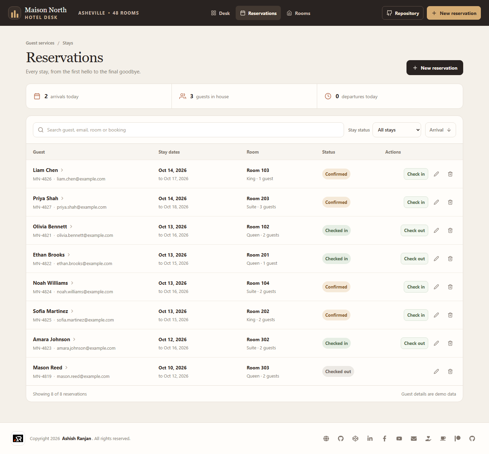
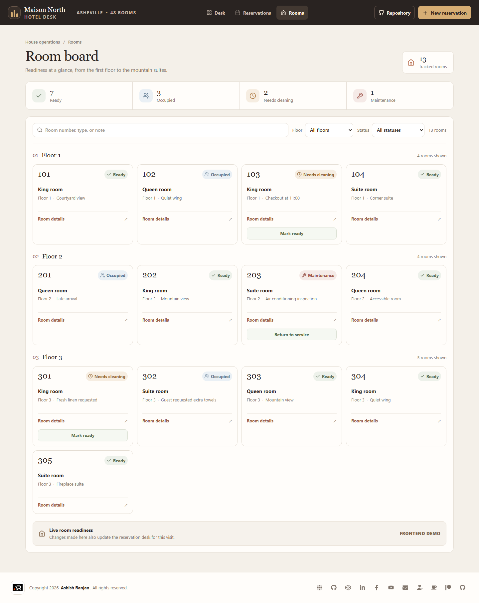
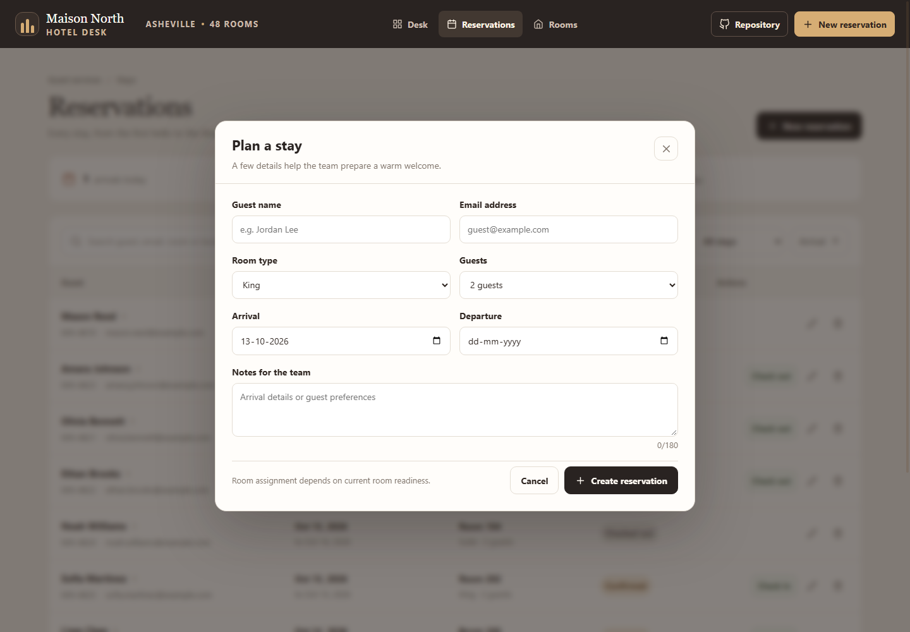
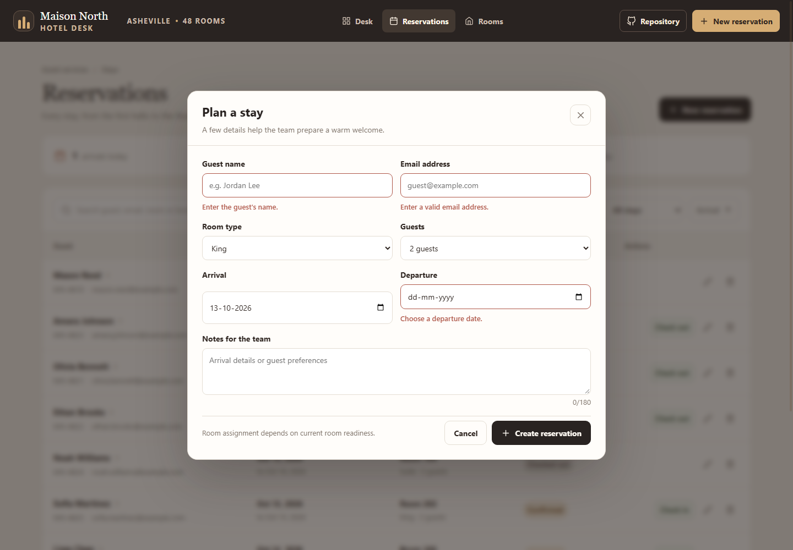
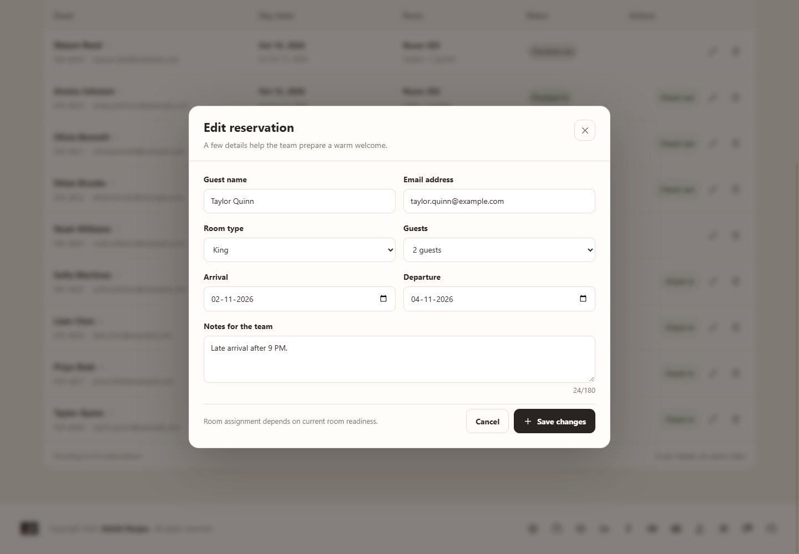
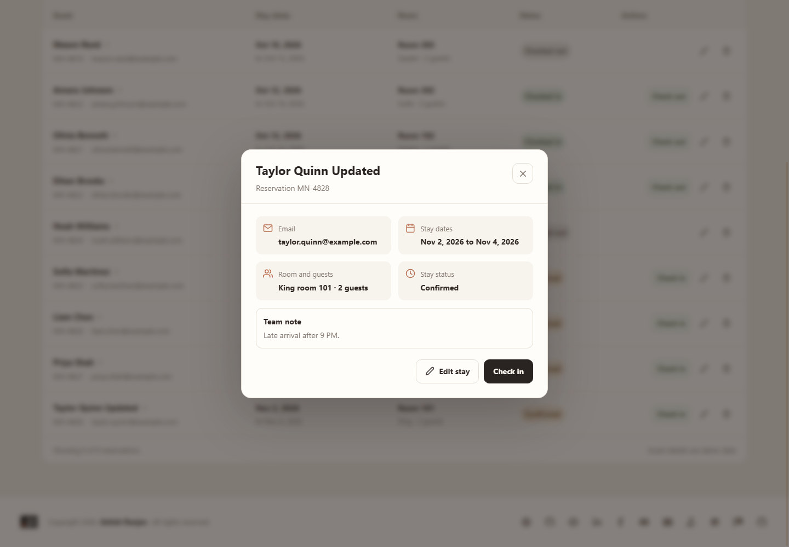
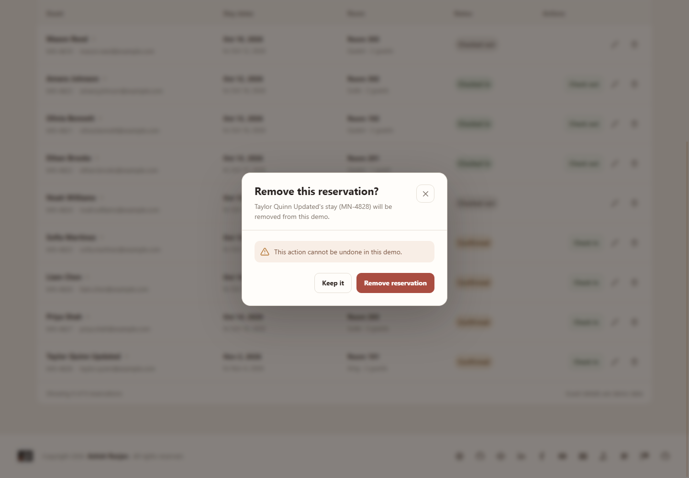
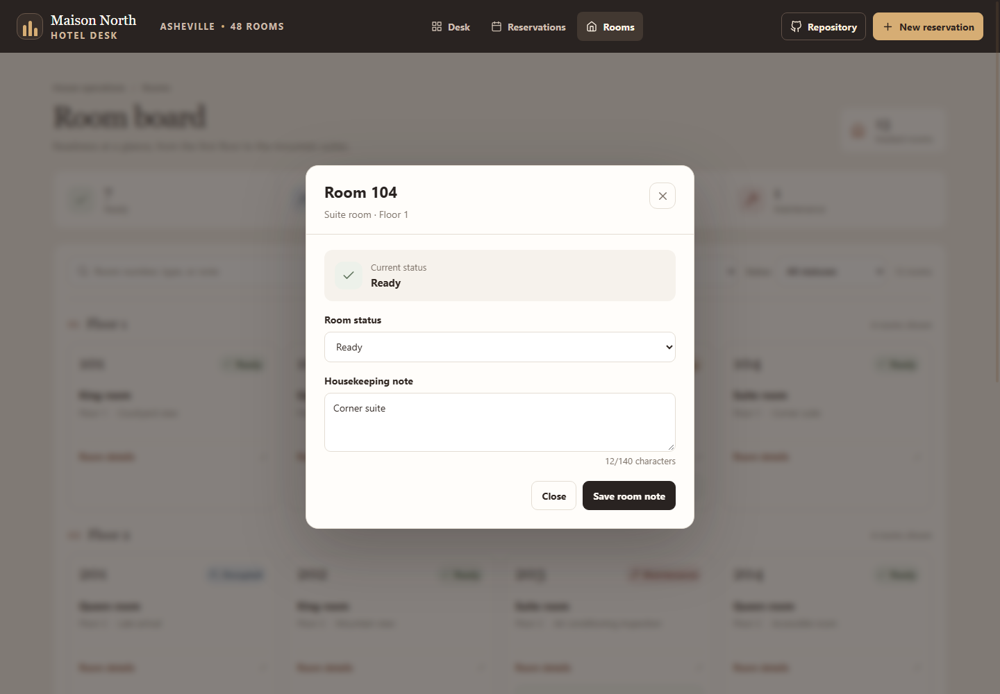



# Maison North Hotel Operations

A frontend-only hotel operations interface for managing daily arrivals, reservations, room readiness, and guest stays.

**Live demo:** [a2rp.github.io/hotel-property-management](https://a2rp.github.io/hotel-property-management/)

## What the demo includes

- **Hotel desk** (`/overview`): current arrivals, departures, occupancy, and room readiness, with actions to check guests in and mark rooms ready.
- **Reservations** (`/reservations`): search guests, filter by stay status, sort by arrival, inspect reservation details, and create, edit, check in, check out, or remove a stay after confirmation.
- **Room board** (`/rooms`): browse rooms by floor, search by room number/type/note, filter status, update readiness, and edit housekeeping notes.
- Changes share React state across pages during the current visit. A refresh restores the seeded demo data. No backend, persistent browser storage, booking channel, or payment service is connected.

## Run locally

```bash
npm install
npm run dev
```

Run checks and deploy to GitHub Pages with:

```bash
npm run lint
npm run build
npm run deploy
```

The deploy script builds the Vite app, copies `dist/index.html` to `dist/404.html` for GitHub Pages route fallback, then publishes `dist` to the `gh-pages` branch.

## Screenshots

These captures show the current production build and its primary routes and dialogs.

### Pages

| Page | Screenshot |
| --- | --- |
| Hotel desk |  |
| Reservations |  |
| Room board |  |
| Not found |  |

### Dialogs

| Dialog | Screenshot |
| --- | --- |
| Create reservation |  |
| Form validation |  |
| Edit reservation |  |
| Reservation details |  |
| Remove reservation confirmation |  |
| Room details |  |

## Future improvements

- Connect reservations and room inventory to a shared hotel API with team accounts and role-based permissions.
- Add real booking-channel synchronization, payment processing, and guest messaging through external service integrations.
- Add server-backed housekeeping assignments, maintenance requests, and audit history for changes across a team.

## Links

- Portfolio: [https://www.ashishranjan.net](https://www.ashishranjan.net)
- GitHub: [https://github.com/a2rp](https://github.com/a2rp)
- CodePen: [https://codepen.io/ash1198](https://codepen.io/ash1198)
- LinkedIn: [https://www.linkedin.com/in/aashishranjan](https://www.linkedin.com/in/aashishranjan)
- Facebook: [https://www.facebook.com/theash.ashish/](https://www.facebook.com/theash.ashish/)
- YouTube: [https://www.youtube.com/@ashishranjan-ashz?sub_confirmation=1](https://www.youtube.com/@ashishranjan-ashz?sub_confirmation=1)
- Email: [mailto:ash.ranjan09@gmail.com](mailto:ash.ranjan09@gmail.com)

## Support

- Support: [https://a2rp-donation-page.netlify.app/](https://a2rp-donation-page.netlify.app/)
- Buy Me a Coffee: [https://buymeacoffee.com/ashishranjan](https://buymeacoffee.com/ashishranjan)
- Patreon: [https://www.patreon.com/ashishranjan](https://www.patreon.com/ashishranjan)
