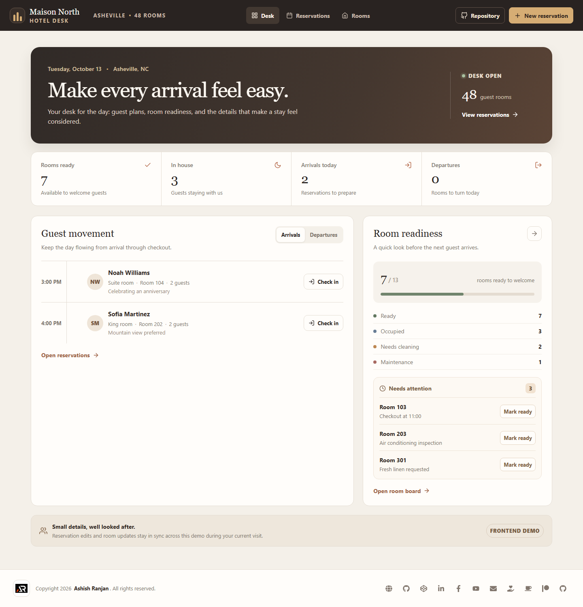
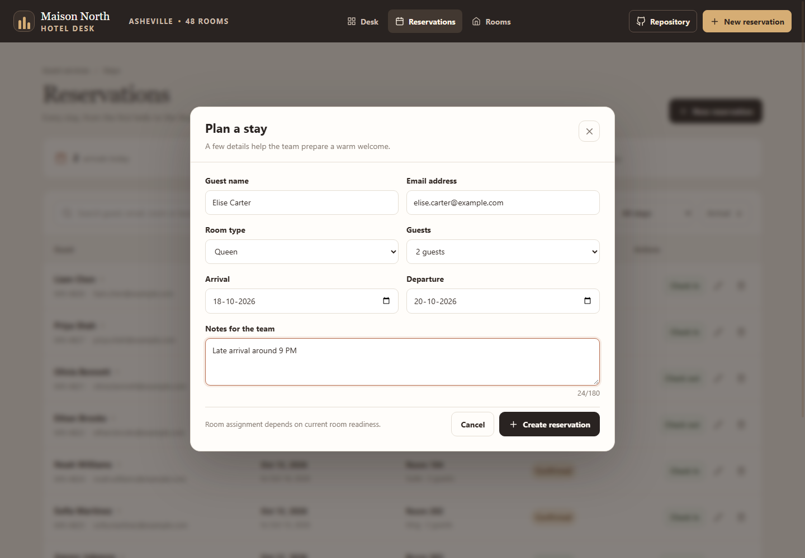
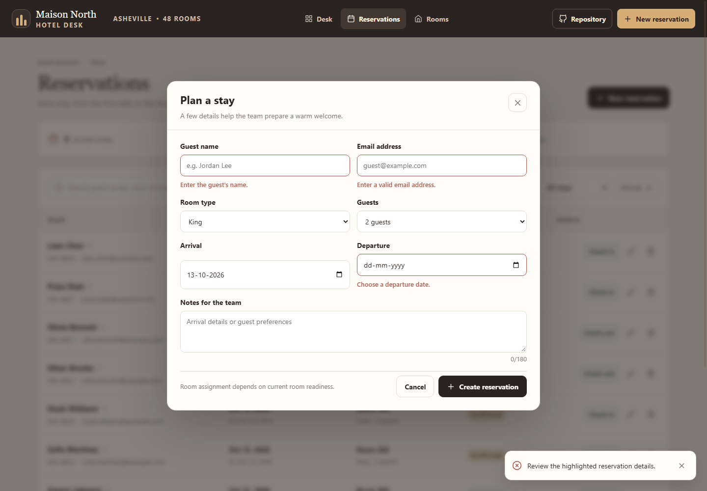
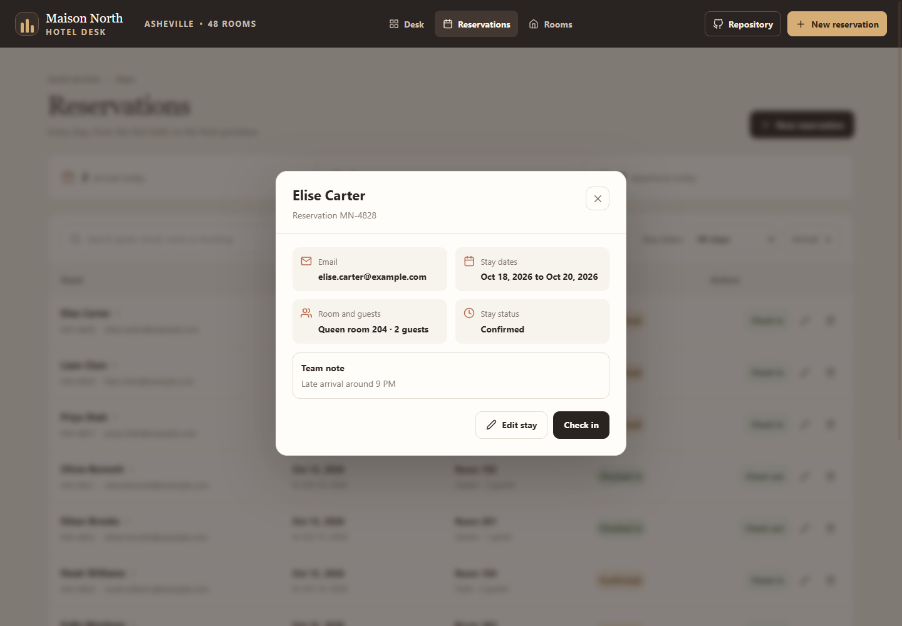
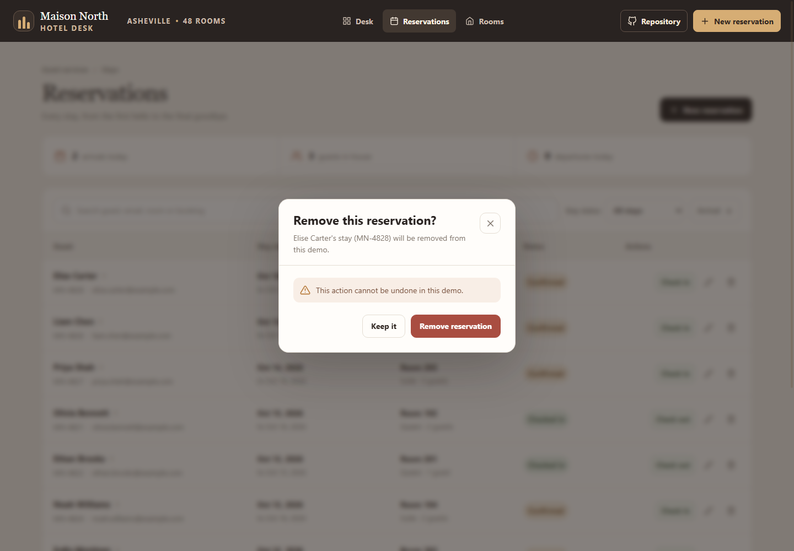
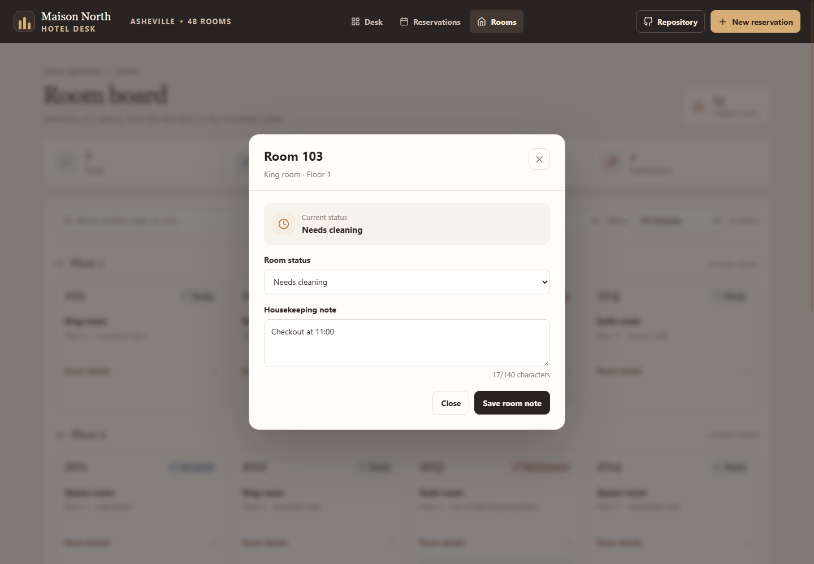
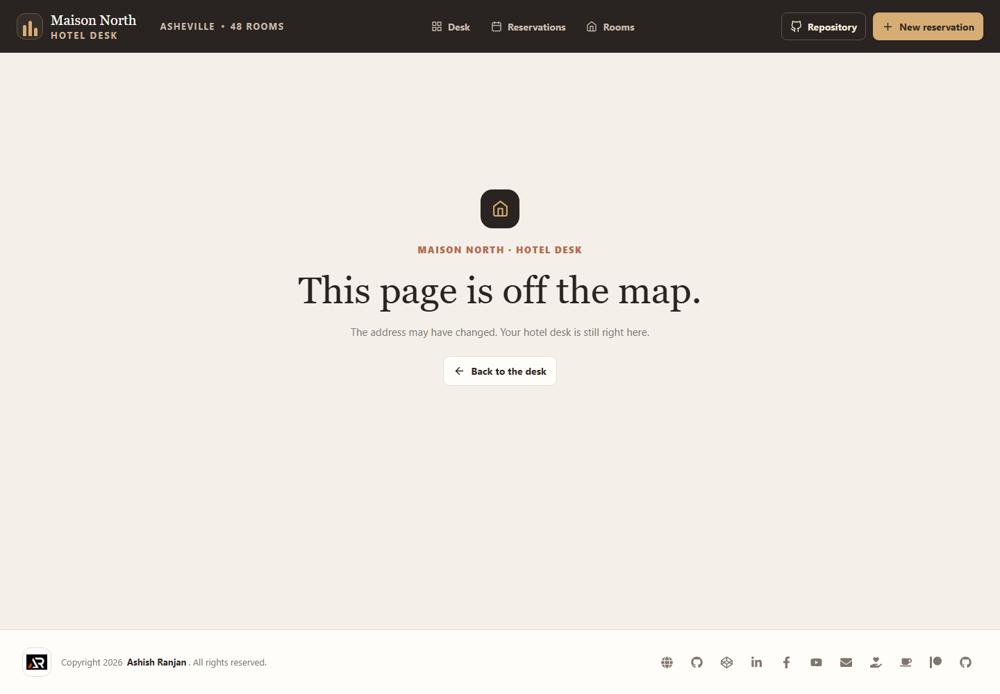

# Maison North Hotel Operations


A frontend-only hotel property management demo for guest reservations, room readiness, check-in, and checkout workflows.

## Pages

- **Desk** at `/overview` shows arrivals, departures, occupancy, and room readiness.
- **Reservations** at `/reservations` supports guest search, status filters, arrival sorting, reservation details, create, edit, check-in, checkout, and confirmed removal.
- **Room board** at `/rooms` groups rooms by floor and supports room search, status filters, readiness updates, and housekeeping notes.

Reservation and room changes share React state across the pages during the current visit. Refreshing the page restores the sample data. The demo uses no backend or persistent browser storage, and it does not connect to a booking channel or process payments.

## Run locally

```bash
npm install
npm run dev
```

Run the project checks and publish the built site with:

```bash
npm run lint
npm run build
npm run deploy
```

The deploy script builds the Vite app, copies the app entry to `404.html` for GitHub Pages route fallback, and publishes the `dist` folder to the `gh-pages` branch.

## Screenshots

### Overview desk



### Reservations


### Room board


### Reservation form



### Reservation validation



### Reservation details



### Removal confirmation



### Room details



### Not found page



## Future improvements

- Connect reservations and room inventory to a hotel API with team accounts and role-based permissions.
- Add booking channel synchronization, payment processing, and guest messaging through real service integrations.
- Add housekeeping assignments, maintenance requests, and change history backed by shared server data.

## Links

- Repository: [github.com/a2rp/hotel-property-management](https://github.com/a2rp/hotel-property-management)
- Portfolio: [ashishranjan.net](https://www.ashishranjan.net)
